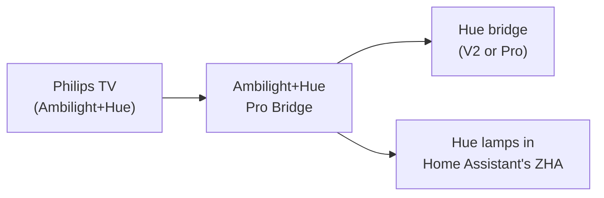

# Ambilight+Hue Pro Bridge

Bring **Ambilight+Hue** back to older Philips TVs. Philips dropped the feature from the new
**Hue Pro bridge** in favour of a separate Hue Sync box. This bridge stands in for the Hue bridge
the TV expects and passes its colours on to a modern Hue bridge (V2 or Pro), or straight to Hue
lamps in Home Assistant's **ZHA**, without any Hue bridge at all.

[](https://my.home-assistant.io/redirect/supervisor_add_addon_repository/?repository_url=https%3A%2F%2Fgithub.com%2Fmarcelveldt%2Fambilight-hue-pro-bridge)



- Works with older TVs (found over SSDP) and newer Android TVs (found over mDNS)
- Low latency, over the Hue Entertainment API
- A gradient light (a Signe or gradient lightstrip) shows several colours, one per zone
- Several TVs, each with its own lights, smoothing and priority
- Light on resources: an idle bridge does next to nothing

## What you need

- A Philips TV with **Ambilight+Hue**
- A **Hue bridge** (the square V2 or the Pro) with an entertainment area, or Hue colour lamps in
  Home Assistant's ZHA running on Ziggurat
- A machine on the same network to run the bridge: **Home Assistant** (as an app) or **Docker**. It
  needs host networking and port 80, because the TV expects a Hue bridge there.

## Installation

### Home Assistant app

Click the button above, or add this repository under **Settings → Apps → Install app → ⋮ →
Repositories**:

```
https://github.com/marcelveldt/ambilight-hue-pro-bridge
```

Install **Ambilight+Hue Pro Bridge**, start it, and open **Ambilight Bridge** in the sidebar.
[addon/README.md](addon/README.md) lists the app's options.

### Docker

```bash
docker run -d --name ambilight-hue-bridge \
  --network host \
  --restart unless-stopped \
  -v ambilight-hue-bridge-data:/data \
  ghcr.io/marcelveldt/ambilight-hue-pro-bridge:latest
```

Then open the web UI at `http://<host>`. Settings and the log live in the `/data` volume. Optional
environment variables: `HTTP_PORT` (default `80`), `LOG_LEVEL` (`verbose`, `debug`, `info`,
`warning` or `error`), `LOG_FILE`, `HTTPS_PORT` (a TLS listener, off by default; the TVs use plain
HTTP).

## Setting up

1. **Pair your Hue bridge.** In the web UI, enter the bridge's IP address or click **Find bridge**,
   click **Pair**, then press the link button on the bridge within 30 seconds. Using only Zigbee
   lamps? Skip this; see [Zigbee lamps without a Hue bridge](#zigbee-lamps-without-a-hue-bridge).
2. **Pair the TV.** Run the Ambilight+Hue setup on the TV and let it search for a Hue bridge. It
   finds this bridge and shows up in the web UI.
3. **Give the TV its lights.** A new TV gets your first entertainment area; pick another area or
   Zigbee lamps on its card. Then place the lights around the screen in the TV's Ambilight+Hue menu.

Does the TV find your real Hue bridge instead? See
[The TV connects to the real Hue bridge](#the-tv-connects-to-the-real-hue-bridge).

## Zigbee lamps without a Hue bridge

When Home Assistant's ZHA runs on Ziggurat, a TV can stream straight to Hue colour lamps on that
Zigbee network. On the TV's card, set **Lights** to **Zigbee lamps (Home Assistant)** and tick up
to 10 lamps. The TV sees one light per lamp, and three per gradient lamp.

- As a Home Assistant app the bridge reaches Home Assistant by itself. Run elsewhere, enter Home
  Assistant's address and a long-lived access token of an administrator under **Home Assistant
  connection**.
- Pick lamps within radio range of each other, such as the lamps in one room: the colours go to one
  lamp, which passes them on to the others.
- The lamps go back to how they were when the TV stops.
- While another app (such as Music Assistant's Hue Lights Sync) streams to one of the lamps, the TV
  waits and tries again every minute.

## Several TVs

Each TV has its own card with an **Enabled** switch. Under **Advanced**:

- **Smoothing** fades between colours. **Auto** turns it on for older TVs, which update about once
  a second, and off for TVs that stream; **Off**, **Light** and **Strong** set it by hand.
- **Priority** (0 to 100, once two or more TVs are paired) decides which TV streams when several
  want the same lights. The higher value wins, and on a tie the TV that streams keeps going.

A Hue bridge streams to one TV at a time. TVs on different lights stream side by side, except that
Zigbee carries at most two streams: the TV with the highest priority at 25 frames a second, the
next at a lower rate.

## Control from Home Assistant

The per-TV settings have a small JSON API, for a REST command or REST sensor in Home Assistant:

```bash
curl http://<bridge-host>/cfg/tvs                 # every paired TV and its settings
curl http://<bridge-host>/cfg/tvs/<username>      # one TV
curl -X PUT http://<bridge-host>/cfg/tvs/<username> \
  -H 'Content-Type: application/json' \
  -d '{"enabled": false, "stream_priority": 25}'
```

`stream_smoothing` takes `null` for Auto, or a value from 0 (off) to 0.95.

As a Home Assistant app, the web UI and this API only answer Home Assistant itself: use `127.0.0.1`
as `<bridge-host>`; other devices get a 403. Run standalone, they have no authentication, so keep
them on a trusted network.

## Troubleshooting

<a name="the-two-bridge-catch-important"></a>

### The TV connects to the real Hue bridge

Your real Hue bridge announces itself on the network just like this one, so a newer TV can pick the
real one. The Hue Pro bridge no longer speaks Ambilight+Hue, so the TV then does nothing. This
happens on your own network, not in Philips' cloud, so blocking `discovery.meethue.com` does not
help.

To get the TV onto this bridge: **unplug the real bridge, restart the TV, run the Ambilight+Hue
setup, then plug the real bridge back in.**

The TV sticks to this bridge until it loses it, for example while this bridge restarts for an
update, and may then pick the real one again. For good, put the real bridge (or the TV) on its own
VLAN or isolated subnet that this bridge can still reach; it only needs the address. A guest network
does not work, because it would cut this bridge off too. Without VLANs, unplug the real bridge
during updates.

## How it works

The bridge presents a virtual Hue bridge on the network: it answers discovery and the legacy Hue
API the TV speaks, and receives the TV's colours (over DTLS from newer TVs, about once a second
over HTTP from older ones). It maps them onto the channels of an entertainment area, or onto the
Zigbee lamps, and streams them out with the
[hue-entertainment](https://github.com/music-assistant/hue-entertainment) library it shares with
Music Assistant. Protocol notes and the module map are in [docs/ARCHITECTURE.md](docs/ARCHITECTURE.md).

## Development

Requires Python 3.13+.

```bash
scripts/setup.sh                                    # venv, dependencies and pre-commit
python -m ambilight_hue_bridge --log-level debug    # web UI and Hue API on port 8080
sudo ambilight-hue-bridge --http-port 80            # the TVs expect port 80
pre-commit run --all-files
pytest
```

Every flag also has an environment variable (`HTTP_PORT`, `HTTPS_PORT`, `LOG_LEVEL`, `LOG_FILE`,
`DATA_DIR`); a flag wins over the app's options, which win over the environment. `pair` and `areas`
commands help with a headless setup. Logs go to the console and to `<data-dir>/bridge.log`.

The code follows the conventions of [aiohue](https://github.com/home-assistant-libs/aiohue),
[aiosonos](https://github.com/music-assistant/aiosonos) and
[Music Assistant](https://github.com/music-assistant/server), with [Ruff](https://docs.astral.sh/ruff/)
for linting and formatting.

## Credits

- [diyHue](https://github.com/diyhue/diyHue): reference for emulating a Hue bridge and its
  entertainment streaming server.
- Home Assistant's [`emulated_hue`](https://github.com/home-assistant/core): SSDP/UPnP and v1 API
  emulation patterns.
- [Music Assistant](https://github.com/music-assistant/server): the Hue Entertainment streaming
  client this project's client is derived from.

## License

[Apache 2.0](LICENSE)
